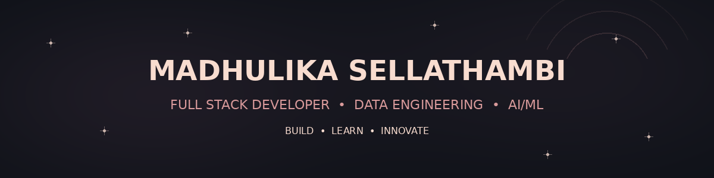

<!-- ================================================= -->
<!-- MADHULIKA SELLATHAMBI | GITHUB PROFILE VERSION 4.1 -->
<!-- HYBRID PLUM ROSE THEME                            -->
<!-- ================================================= -->

<!-- ================= HERO ================= -->

 

  

  

**BUILDING • LEARNING • INNOVATING**

---

<!-- ================= ABOUT ME ================= -->

## 🌸 About Me

I'm **Madhulika Sellathambi**, a Computer Science postgraduate who builds full-stack and AI-powered applications.

- 💻 Interested in Full Stack Development.
- 🤖 Experienced in AI-assisted software development and LLM applications.
- 🧠 Exploring prompt engineering and Generative AI.
- 📊 Learning Data Engineering and Analytics.
- 🚀 Passionate about understanding, reviewing and improving code.
- 🌍 Based in Tamil Nadu, India.

> Curious about why code works, not just whether it runs.

---

<!-- ================= TECH STACK ================= -->

## ⚡ Tech Stack & Technologies

### 👩🏻‍💻 Programming Languages

### 🌐 Application Development

### 🗄️ Databases & Tools

### 🤖 AI & Data Technologies

### 🔭 Currently Learning

---

<!-- ================= PROJECTS ================= -->

## 🚀 Featured Projects

<table>
<tr>
<td width="50%" valign="top">

### 📰 Driftwire

**AI-Powered News Aggregator**

- AI-assisted article summaries.
- Topic-based news filtering.
- Sentiment classification using VADER.
- Flask REST APIs and React frontend.

**Stack:** Python, Flask, React.js, Claude API, NLP, VADER

</td>

<td width="50%" valign="top">

### ✋ Sign Language Recognition

**Real-Time Gesture Recognition**

- Created a custom hand-gesture dataset.
- Extracted 21 hand landmarks using MediaPipe.
- Developed real-time gesture classification.
- Achieved 85%+ recognition accuracy.

**Stack:** Python, OpenCV, MediaPipe, Machine Learning

</td>
</tr>

<tr>
<td width="50%" valign="top">

### ✈️ Flight Accident Prediction

**ANN-Based Prediction System**

- Developed an Artificial Neural Network.
- Applied data preprocessing and feature selection.
- Predicted flight accident risk before takeoff.

**Stack:** Python, ANN, Deep Learning, Machine Learning

</td>

<td width="50%" valign="top">

### 🎓 Student Record Management

**Web-Based Management System**

- Developed a student record management application.
- Implemented database integration.

**Stack:** PHP, MySQL, HTML, CSS

</td>
</tr>
</table>

### 🌐 More Web Development Work

---

<!-- ================= EXPERIENCE ================= -->

## 💼 Work Experience

### 🤖 AI & Generative AI Intern

**Marcello Tech | May 2025 – June 2025**

- Explored Generative AI, prompt engineering and Large Language Models.
- Developed AI-assisted software solutions using Python.
- Built and tested Driftwire, an AI-powered news aggregator.
- Integrated Claude-assisted summaries with Flask REST APIs and React.js.
- Used NLP and VADER for sentiment classification.

### 💻 Full Stack Development Intern

**Main Flow Services & Technologies | June 2024 – August 2024**

- Completed 8+ web development projects.
- Developed and deployed a Music Playlist Website.
- Implemented music discovery and playlist management.
- Built a MERN-based login and registration system.
- Developed responsive landing pages and web interfaces.

---

<!-- ================= EDUCATION ================= -->

## 🎓 Education

### Master of Computer Science

**Bharathidasan University**

Government College for Women (Autonomous), Kumbakonam

2024 – 2026

### Bachelor of Computer Science

**Bharathidasan University**

Government College for Women (Autonomous), Kumbakonam

2021 – 2024

---

<!-- ================= ACHIEVEMENTS ================= -->

## 🏆 Certifications & Leadership

### 📜 Certifications

- **Cloud Data Engineering — Zeyobron**
  - Currently learning Databricks, PySpark and data pipeline concepts.

- **Data Analytics using Power BI**
  - Microsoft & SAP.
  - TNSDC Naan Mudhalvan – Edunet Foundation.
  - June 2024.

- **AI & Python Certification**
  - SWAiT.AI powered by GUVI.

### 🌟 Leadership & Activities

- **Vice President – Department Association**
  - Organized student activities and departmental events.
- **National-Level AI Hackathon**
  - Participated in a hackathon focused on language learning models.

---

<!-- ================= GITHUB ANALYTICS ================= -->

## 📊 GitHub Analytics

  

---

---

## 🐍 My Contribution Journey

---

<!-- ================= CONNECT ================= -->

## 🤝 Let's Connect

  

  

**💜 Dream • Develop • Deliver**

 

<!-- =============== END OF README =============== -->
