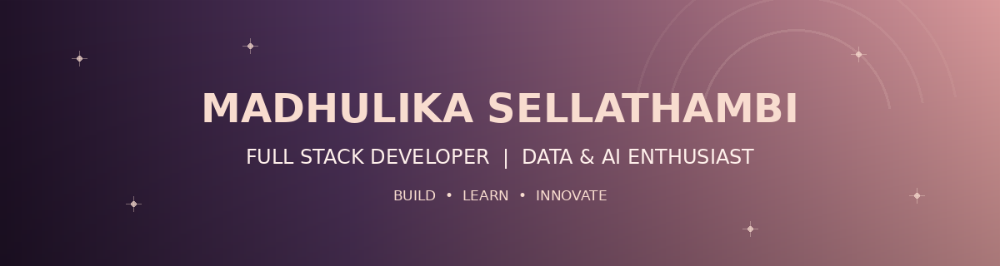

<!-- ================================================== -->
<!--              MADHULIKA - PROFILE V4                -->
<!--              HYBRID PLUM ROSE THEME                -->
<!-- ================================================== -->

<!-- ================= HERO SECTION ================= -->

 

  

  

**BUILDING • LEARNING • INNOVATING**

---

<!-- ================= ABOUT ME ================= -->

## 🌸 About Me

Hello! I'm **Madhulika Sellathambi**, a Computer Science postgraduate passionate about software development, data and emerging technologies.

- 🎓 MSc Computer Science Graduate.
- 💻 Full Stack Development enthusiast.
- 📊 Exploring Data Engineering and Analytics.
- 🤖 Interested in AI and Machine Learning.
- 🧠 Passionate about DSA and Problem Solving.
- 🚀 Enjoy building real-world applications.
- 🌍 Based in Tamil Nadu, India.

 

*"Great things are built one line of code at a time."*

---

<!-- ================= TECH STACK ================= -->

## ⚡ Tech Stack & Technologies

### 👩🏻‍💻 Programming Languages

### 🌐 Frontend Development

### ⚙️ Backend Development

### 🗄️ Database & Developer Tools

### 🤖 AI & Machine Learning

### 🔭 Currently Exploring

---

<!-- ================= PROJECTS ================= -->

## 🚀 Featured Projects

<table>
<tr>
<td width="50%" valign="top">

### 📰 News Sentiment Aggregator

Live news sentiment analysis using NLP.

**Technologies:** React.js • Flask • Python • VADER

</td>

<td width="50%" valign="top">

### 🎓 Student Record Management

A student record management system.

**Technologies:** PHP • MySQL • HTML • CSS

</td>
</tr>

<tr>
<td width="50%" valign="top">

### 🍔 Food Order Website

A responsive food ordering website.

**Technologies:** HTML • CSS

</td>

<td width="50%" valign="top">

### 🌐 Digital Portfolio

Personal portfolio showcasing development skills.

**Technologies:** HTML • CSS • JavaScript

</td>
</tr>
</table>

### 🧪 Other Technical Projects

| Project | Technology |
|---|---|
| Real-Time Sign Language Recognition | Python, MediaPipe, TensorFlow, Flask, React |
| Flight Accident Prediction | Python, ANN, Machine Learning |
| Food Delivery Website | HTML, CSS |
| Virtual Science Museum | Web Development |

---

<!-- ================= EXPERIENCE ================= -->

## 💼 Experience & Learning

**Full Stack Web Development Intern**

Main Flow Services & Technologies

- Developed responsive web interfaces.
- Worked with HTML, CSS, JavaScript and React.
- Practised PHP and MySQL integration.
- Built login and registration applications.

**Web Development Intern**

OctaNet Services Pvt Ltd

- Developed a Netflix-inspired landing page using React.

**AI & Python Training**

SWAiT.AI powered by GUVI

- Explored Python and Artificial Intelligence.
- Participated in a GUVI hackathon involving Indian-language datasets.

---

<!-- ================= ACHIEVEMENTS ================= -->

## 🏆 Achievements & Activities

- 🎓 MSc Computer Science graduate.
- 🧠 Vice President of Department Association.
- 🤖 Participated in GUVI AI Hackathon.
- 💻 Built multiple academic and personal projects.
- 📚 Continuously learning Data Engineering and emerging technologies.

---

<!-- ================= EDUCATION ================= -->

## 🎓 Education

### Master of Science in Computer Science

**CGPA: 9.27 / 10**

---

<!-- ================= GITHUB STATISTICS ================= -->

## 📊 GitHub Analytics

  

---

<!-- ================= ACTIVITY GRAPH ================= -->

## 📈 Contribution Activity

---

<!-- ================= CONNECT ================= -->

## 🤝 Let's Connect

  

  

**💜 Thank you for being here!**

*Dream • Develop • Deliver*

 

<!-- =============== END OF PROFILE =============== -->
